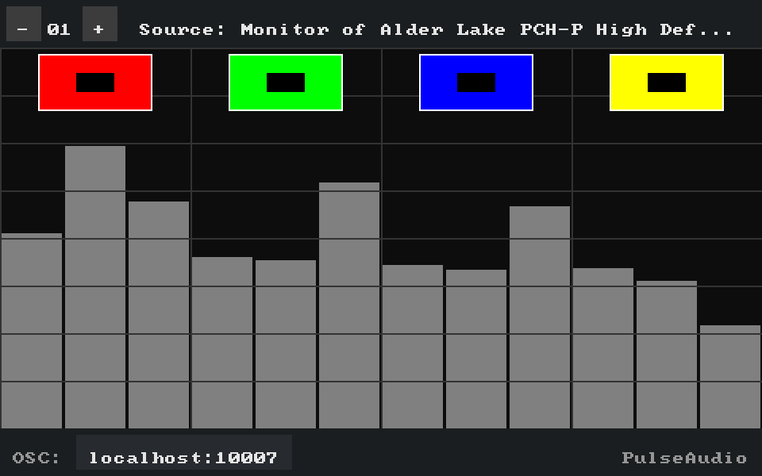

# Spectrum Analyzer

Real-time audio spectrum analyzer with OSC output. Runs on Linux, Windows and
macOS.

*The SDL front end — the one in the downloads — following what is playing.*

Analyses what is playing (or what the microphone hears) in log-spaced bands from
20 Hz to 20 kHz, and streams the level of four draggable boxes over OSC so that
lighting, VJ and video software can follow the music.

## Download

Prebuilt binaries are attached to the [latest release](https://github.com/lupin3rd/spectrum-analyzer/releases/latest):

| Platform | File | Notes |
|---|---|---|
| Linux x86_64 | `Spectrum_Analyzer-x86_64.AppImage` | `chmod +x` and run; no dependencies to install |
| Windows x86_64 | `spectrum-analyzer-windows-x86_64.zip` | Unzip anywhere, run `spectrum-analyzer-sdl.exe` |
| macOS arm64 | `Spectrum-Analyzer-macos-arm64.zip` | Right-click → Open on first launch (ad-hoc signed) |

On Linux the AppImage may need `--appimage-extract-and-run` if FUSE is not
installed.  Intel Macs and other architectures can build from source.

## Using it

    spectrum-analyzer                        # default capture source
    spectrum-analyzer --list-sources         # list capture sources and exit
    spectrum-analyzer <source>               # capture from a specific source
                                             #   (an id from --list-sources, or
                                             #    any part of its name)
    spectrum-analyzer --version

Pick the capture device from the `Source:` list — on PulseAudio/PipeWire the
`Monitor of …` entries analyse what is playing rather than what is recorded.
The number in the toolbar (`01`…`100`) namespaces the OSC addresses, so several
instances can run at once, each on a different source.

Drag the coloured boxes over the spectrum to select a frequency range; drag an
edge to resize.  Each box streams its activation — how much of the box is filled
by the bars — over OSC:

    /spectrum-analyzer/<nn>/<Name>           <float 0..1>

| | |
|---|---|
| `Source: … v` | capture device list (`S` cycles, `↑`/`↓` + `Enter` inside the list) |
| `+` / `-` | analyzer number |
| `OSC:` field | click to type `host:port`; `Enter` applies it |
| `F` | fullscreen |
| `Esc` | quit |

The GTK front end adds a tray icon, a quit confirmation and a native file-menu
look; it is the same program with a different shell.

## Build

### Linux

    sudo apt-get install build-essential libfftw3-dev liblo-dev libsdl3-dev
    make sdl
    ./spectrum-analyzer-sdl

The GTK front end needs GTK 3 instead of SDL 3:

    sudo apt-get install libgtkmm-3.0-dev libepoxy-dev
    make
    ./spectrum-analyzer

No `libpulse`/`libasound` development package is required: capture goes through
the vendored miniaudio (see [`vendor/README.md`](vendor/README.md)), which loads
the sound server at runtime.

### macOS

    brew install sdl3 fftw liblo pkgconf
    make sdl

`./packaging/build-macos-app.sh` wraps it into a `.app` bundle.

### Windows

In an MSYS2 UCRT64 shell:

    pacman -S --needed mingw-w64-ucrt-x86_64-gcc mingw-w64-ucrt-x86_64-pkgconf \
        mingw-w64-ucrt-x86_64-sdl3 mingw-w64-ucrt-x86_64-fftw \
        mingw-w64-ucrt-x86_64-liblo make
    make sdl

The result is `spectrum-analyzer-sdl.exe` plus the DLLs next to it.

### Tests

    make test        # 147 assertions, no display and no audio device needed
    make asan        # same sources with AddressSanitizer + UBSan

The analysis core (`spectrum-dsp`) and the filter boxes (`filter`) are pure: they
have no I/O, no threads and no platform headers, which is what makes them
testable and what made the port to three platforms cheap.

## Packaging

| Platform | Command | Output |
|---|---|---|
| Linux | `make appimage` | `Spectrum_Analyzer-x86_64.AppImage`, ~8 MB |
| Linux | `make install PREFIX=/usr/local` | GTK front end, desktop file and icons |
| Windows | `make sdl` | `.exe` plus DLLs (liblo has no static library in MSYS2) |
| macOS | `./packaging/build-macos-app.sh` | `Spectrum Analyzer.app` in a zip |

[`.github/workflows/`](.github/workflows/) builds and tests all three on every
push, and a `v*` tag produces the release with every artifact attached.

## Front ends

Two user interfaces share the same analysis, capture and OSC modules:

| Target | Binary | Toolkit | Where |
|---|---|---|---|
| `make sdl` | `spectrum-analyzer-sdl` | SDL 3 — rectangles and lines, no OpenGL profile, no widget toolkit | Linux, Windows, macOS |
| `make` | `spectrum-analyzer` | GTK 3 + OpenGL core | Linux desktop |

The SDL front end exists because GTK 3's `GtkGLArea` does not work on macOS at
all.  See [`docs/CROSS-PLATFORM.md`](docs/CROSS-PLATFORM.md) for the reasoning
and [`docs/AUDIT.md`](docs/AUDIT.md) for the state of the code.

## Layout

| File | Role |
|---|---|
| `spectrum-dsp.{h,cc}` | Analysis core: windowing, FFT, log bands, envelope follower. |
| `audio-sampler.{h,cc}` | Capture via miniaudio, with automatic reconnect. |
| `message-bus.{h,cc}` | OSC destination and senders (liblo). |
| `app-sdl.cc` | SDL 3 front end: window, renderer, input, frame loop. |
| `spectrum-analyzer-window.{h,cc}`, `my-drawing-area.{h,cc}` | GTK 3 front end. |
| `filter.{h,cc}` | The draggable boxes: hit testing, dragging, resizing, activation. |
| `gl-compat.{h,cc}` | Immediate-mode style drawing on an OpenGL 3.2 core profile. |
| `version.h` | The only copy of the version number. |
| `vendor/miniaudio.h` | Vendored capture library. |
| `tests/` | Headless test suites. |

## Versioning

Semantic versioning, with the caveat that this is an application: a major bump
means the product changed shape (a front end removed), not that an API broke.

| Line | Branch | Content |
|---|---|---|
| `1.0.x` | `1.x` | GTK only, for everyone who stays on the desktop GTK build |
| `1.1.x` | `main` | both front ends, portable audio, packaged for three platforms |

Whether the GTK front end is dropped in a future 2.0 depends on how 1.1.x is
received.

This repository (GitHub) is the **release repository**: it carries one commit per
release.  Development happens on a private Gitea instance, which keeps the full
history and the coding-agent transcripts; see
[`docs/RELEASING.md`](docs/RELEASING.md).

## Docs

- [`CHANGELOG.md`](CHANGELOG.md) — what changed, release by release.
- [`docs/AUDIT.md`](docs/AUDIT.md) — code audit: fixed defects, open decisions.
- [`docs/CROSS-PLATFORM.md`](docs/CROSS-PLATFORM.md) — what the port required.
- [`vendor/README.md`](vendor/README.md) — the vendored audio library.

## Support

Spectrum Analyzer is free and GPL-3.0. If it is useful to you, you can buy me a
coffee — a thank-you, never a requirement.

## License

GPL-3.0-or-later — see [LICENSE](LICENSE).

The program links FFTW (GPL v2 or later, compatible with GPL-3). GTK 3, liblo
and libepoxy are LGPL-2.1+/MIT, and the vendored miniaudio is public domain /
MIT-0.

This is a fork of [luz](https://github.com/lighttroupe/luz), ported to GTK 3 and
modern OpenGL, and later to SDL 3 with portable audio capture.
